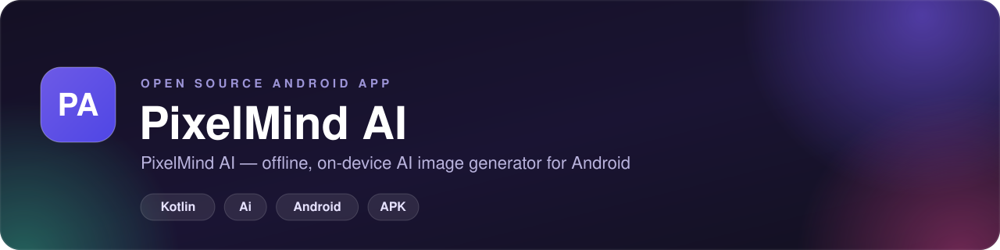

<div align="center">



<a href="https://github.com/technicalnihilist-lgtm/pixelmind-ai/stargazers"></a>&nbsp;<a href="https://github.com/technicalnihilist-lgtm/pixelmind-ai/network/members"></a>

<a href="https://github.com/technicalnihilist-lgtm/pixelmind-ai/releases/latest"></a>

<b>Support the work</b>

  

<sub>Donations aren't live yet — Paytm, UPI, PayPal and Buy&nbsp;Me&nbsp;a&nbsp;Coffee all show <b>coming soon</b>. Until then, a ⭐ star is the best support.</sub>

<a href="https://github.com/technicalnihilist-lgtm/pixelmind-ai/releases/latest"></a>  <a href="https://github.com/technicalnihilist-lgtm/pixelmind-ai/releases"></a>

</div>

---

## Status — read this first

This repository is an honest snapshot, not a launch announcement. Here is exactly what is
verified and what is not.

| Claim | State |
| --- | --- |
| Project compiles, APKs build | **Verified.** `assembleDebug` and `assembleRelease` both succeed. |
| Unit tests pass | **Verified.** 13/13 pass (`./gradlew :app:testDebugUnitTest`). |
| Manifest requests no platform permissions | **Verified** on the built APK with `aapt2 dump permissions`. |
| Real ONNX inference code (no mocks, no stock images) | **Implemented** — CLIP BPE tokenizer, LCM scheduler, UNet/VAE graph execution. |
| Weights bundled in the APK | **Yes** — the *verification* model (8.2 MB): real ONNX graphs with the same shapes as the SD pipeline, untrained weights. |
| Image generation works in the shipped APK | **Yes, end to end** — tokenizer → conditioning → 4 LCM steps → VAE → PNG, on device, offline. Output is smooth abstract colour fields, **not** photoreal imagery. |
| Photoreal / SD-quality output | **No.** Needs the Stable Diffusion export: `tools/export_model.py`. No public pre-exported model below ~950 MB is usable — see [docs/MODEL_OPTIONS.md](docs/MODEL_OPTIONS.md). |
| Tested on a physical device | **Not done.** No Android hardware was available to this build. |
| Airplane-mode generation verified | **Not done** (depends on the two rows above). |
| Screenshots | The images in `design/` are **UI renders produced from the Compose layout**, not device screenshots. |

Anything below marked "measured" was measured on the build machine described in
[docs/MEASUREMENTS.md](docs/MEASUREMENTS.md). Nothing is estimated without saying so.

---

## Two models, one pipeline

| | Verification model (shipped) | Production model (opt-in) |
| --- | --- | --- |
| Weights | 8.2 MB, synthetic | ~600 MB, SD 1.5 + LCM-LoRA |
| Build | `tools/make_tiny_model.py` | `tools/export_model.py` |
| Output | smooth abstract colour fields | photoreal / artistic images |
| Purpose | proves the on-device path runs | the actual product |

The shipped APK generates images today. It does not pretend they are photographs: the weights are
untrained, so what comes out is prompt-dependent abstract colour — honest output from a real
pipeline rather than a stock image presented as AI.

Every pre-exported ONNX alternative was surveyed, measured and load-tested; the results (including
one widely-mirrored "int8" export that is structurally broken) are in
**[docs/MODEL_OPTIONS.md](docs/MODEL_OPTIONS.md)**. Short version: nothing usable exists below
~950 MB, and a 300 MB diffusion model does not exist at all.

Swapping in the real model is a build step, not a code change:

```bash
python tools/export_model.py --out app/src/main/assets/models   # ~20-40 min, needs ~16 GB RAM
python tools/verify_export.py app/src/main/assets/models
./gradlew :app:assembleRelease && adb install -r app/build/outputs/apk/release/app-release.apk
```

Full walkthrough, including the asset-pack trap that makes a correct export look broken:
**[docs/GETTING_IT_RUNNING.md](docs/GETTING_IT_RUNNING.md)**.

---

## Architecture

```
 ┌───────────────┐   prompt    ┌──────────────────────┐
 │  Compose UI   │────────────▶│  GenerationManager   │  queue · cancel · retry
 │  (screens)    │◀────────────│  (StateFlow)         │
 └───────────────┘  progress   └──────────┬───────────┘
                                          │ LocalAIEngine (interface)
                                          ▼
                               ┌──────────────────────┐
                               │  OnnxDiffusionEngine │
                               │  ┌────────────────┐  │
                               │  │ CLIP encoder   │  │
                               │  │ LCM UNet int8  │  │  ONNX Runtime
                               │  │ VAE decoder    │  │
                               │  └────────────────┘  │
                               └──────────┬───────────┘
                                          ▼
                               ┌──────────────────────┐
                               │  ImageStore → PNG    │
                               │  SQLite history      │
                               └──────────────────────┘
```

The UI never touches ONNX Runtime. Everything the interface can see is `LocalAIEngine`
(`engine/EngineContract.kt`); the runtime, tensor layouts and quantisation stay behind it.

Full detail: [docs/ARCHITECTURE.md](docs/ARCHITECTURE.md).

## Modules

| Path | What lives there |
| --- | --- |
| `app/src/main/java/ai/pixelmind/engine/` | Inference: tokenizer, scheduler, ONNX pipeline, memory guard, model provisioning |
| `app/src/main/java/ai/pixelmind/manager/` | `GenerationManager` — queue, progress, cancellation, engine lifecycle |
| `app/src/main/java/ai/pixelmind/data/` | SQLite history, favourites, prompt history, settings |
| `app/src/main/java/ai/pixelmind/ui/` | Compose screens, Liquid Glass design system, navigation |
| `app/src/main/cpp/` | Optional NEON JNI scheduler (see [docs/BUILD.md](docs/BUILD.md)) |
| `modelpack/` | Play Asset Delivery **install-time** pack that carries the weights |
| `tools/export_model.py` | Exports + quantises Stable Diffusion 1.5 + LCM into the ONNX graphs this app loads |
| `tools/make_tiny_model.py` | Builds the 8 MB verification model that ships in the APK |
| `tools/smoke_test_model.py` | Runs the whole pipeline in Python against any model directory |
| `tools/repair_onnx.py` | Diagnoses and repairs duplicate-tensor-definition bugs in third-party quantised exports |

## Build

```bash
## Measured artifacts

| Artifact | Size |
| --- | --- |
| `app-release.apk` (arm64-v8a, with the 8.2 MB verification model) | 29.0 MB (30,387,428 bytes) |
| `app-release.apk` (earlier build, no weights) | 22.2 MB (23,254,529 bytes) |
| ↳ native (ONNX Runtime) | 16.3 MB uncompressed |
| ↳ dex | 16.2 MB uncompressed |
| ↳ resources + manifest | 0.44 MB uncompressed |
| ↳ bundled verification weights | 8.2 MB uncompressed |

Swapping in the production model grows the install by roughly 0.6–1.2 GB depending on the
precision you export at. That is the honest cost of offline generation — no amount of app-code
optimisation changes it.

## Privacy

No `INTERNET` permission. No networking library. No analytics SDK. No account. Cloud backup and
device-transfer are disabled for every data domain. Details and how to verify:
[docs/PRIVACY.md](docs/PRIVACY.md).

## Model licensing

The pipeline targets **Stable Diffusion 1.5** (CreativeML OpenRAIL-M) with the **LCM-LoRA**
consistency distillation. Both carry use restrictions you must honour if you redistribute the
weights. Read [docs/MODEL.md](docs/MODEL.md) before shipping anything built from this code.

## License

Application code: MIT (see `LICENSE`). Model weights: not included, and not covered by that
license.

---

---

## 🌍 Languages

<sub>Donations are <b>coming soon</b> in every language below — nothing to pay today, nothing to click.</sub>

<div align="center">

<sub><b>हिन्दी · বাংলা · मराठी · తెలుగు · தமிழ் · ગુજરાતી · ಕನ್ನಡ · മലയാളം · ਪੰਜਾਬੀ · ଓଡ଼ିଆ · অসমীয়া · اردو</b></sub>

</div>

<details>
<summary><b>🌍 Open the same message in 53 languages</b></summary>

**🇮🇳 Indian languages**

- **हिन्दी** (Hindi) — ☕ जल्द ही आ रहा है। · ⭐ अगर आपको यह ऐप और हमारा काम पसंद है, तो कृपया रिपॉजिटरी को स्टार दें और हमें फॉलो करें।
- **বাংলা** (Bengali) — ☕ খুব শিগগিরই আসছে। · ⭐ যদি আপনার এই অ্যাপ এবং আমাদের কাজ ভালো লাগে, তবে অনুগ্রহ করে রিপোজিটরিটিকে একটি স্টার দিন এবং আমাদের ফলো করুন।
- **मराठी** (Marathi) — ☕ लवकरच येत आहे. · ⭐ जर तुम्हाला हे ॲप आणि आमचं काम आवडलं असेल, तर कृपया रिपॉझिटरीला स्टार द्या आणि आम्हाला फॉलो करा.
- **తెలుగు** (Telugu) — ☕ త్వరలో రాబోతోంది. · ⭐ మీకు ఈ యాప్, మా పని నచ్చితే, దయచేసి రిపోజిటరీకి ఒక స్టార్ ఇచ్చి మమ్మల్ని ఫాలో అవ్వండి.
- **தமிழ்** (Tamil) — ☕ விரைவில் வருகிறது. · ⭐ உங்களுக்கு இந்த ஆப்பும் எங்க வேலையும் பிடிச்சிருந்தா, தயவுசெஞ்சு இந்த ரெபாசிட்டரிக்கு ஒரு ஸ்டார்…
- **ગુજરાતી** (Gujarati) — ☕ ટૂંક સમયમાં આવી રહ્યું છે. · ⭐ જો તમને આ એપ અને અમારું કામ ગમતું હોય, તો પ્લીઝ રિપોઝિટરીને સ્ટાર આપો અને અમને ફોલો કરો.
- **ಕನ್ನಡ** (Kannada) — ☕ ಶೀಘ್ರದಲ್ಲೇ ಬರುತ್ತಿದೆ. · ⭐ ನಿಮಗೆ ಈ ಆ್ಯಪ್ ಮತ್ತು ನಮ್ಮ ಕೆಲಸ ಇಷ್ಟವಾದರೆ, ದಯವಿಟ್ಟು ರೆಪೊಸಿಟರಿಗೆ ಸ್ಟಾರ್ ಕೊಡಿ ಮತ್ತು ನಮ್ಮನ್ನು ಫಾಲೋ ಮಾಡಿ.
- **മലയാളം** (Malayalam) — ☕ ഉടൻ വരുന്നു. · ⭐ നിങ്ങൾക്ക് ഈ ആപ്പും ഞങ്ങളുടെ പ്രവർത്തനവും ഇഷ്ടപ്പെട്ടെങ്കിൽ, ദയവായി റെപ്പോസിറ്ററിക്ക് ഒരു സ്റ്റാർ…
- **ਪੰਜਾਬੀ** (Punjabi) — ☕ ਜਲਦੀ ਆ ਰਿਹਾ ਹੈ। · ⭐ ਜੇ ਤੁਹਾਨੂੰ ਇਹ ਐਪ ਅਤੇ ਸਾਡਾ ਕੰਮ ਪਸੰਦ ਹੈ, ਤਾਂ ਕਿਰਪਾ ਕਰਕੇ ਰਿਪੋਜ਼ਟਰੀ ਨੂੰ ਸਟਾਰ ਦਿਓ ਅਤੇ ਸਾਨੂੰ ਫਾਲੋ ਕਰੋ।
- **ଓଡ଼ିଆ** (Odia) — ☕ ଖୁବ୍ ଶୀଘ୍ର ଆସୁଛି। · ⭐ ଯଦି ଆପଣଙ୍କୁ ଏହି ଆପ୍ ଏବଂ ଆମର କାମ ଭଲ ଲାଗୁଛି, ତେବେ ଦୟାକରି ରିପୋଜିଟୋରୀକୁ ଗୋଟିଏ ଷ୍ଟାର୍ ଦିଅନ୍ତୁ ଏବଂ ଆମକୁ ଫଲୋ କରନ୍ତୁ।
- **অসমীয়া** (Assamese) — ☕ অতি সোনকালেই আহি আছে। · ⭐ যদি আপুনি এই এপটো আৰু আমাৰ কাম ভাল পায়, তেন্তে অনুগ্ৰহ কৰি ৰিপজিটৰীটোক এটা ষ্টাৰ দিয়ক আৰু আমাক ফ'ল' কৰক।
- **اردو** (Urdu) — ☕ جلد آرہا ہے۔ · ⭐ اگر آپ کو یہ ایپ اور ہمارا کام پسند آئے تو براہ کرم ریپازٹری کو سٹار دیں اور ہمیں فالو کریں۔
- **संस्कृतम्** (Sanskrit) — ☕ शीघ्रमेव आगच्छति।
- **मैथिली** (Maithili) — ☕ जल्दिये आबि रहल अछि।
- **कोंकणी** (Konkani) — ☕ रोखडेंच येता.
- **کٲشُر** (Kashmiri) — ☕ جَلدی یِوان چھُ۔
- **سنڌي** (Sindhi) — ☕ जल्द अची रह्यो आहे।
- **डोगरी** (Dogri) — ☕ जल्दी आ करदा ऐ।
- **ꯃꯤꯇꯩ ꯂꯣꯟ** (Manipuri) — ☕ ꯑꯊꯨꯕꯥ ꯃꯇꯝꯗꯥ ꯂꯥꯛꯀꯅꯤ꯫
- **बर’** (Bodo) — ☕ थाबैनो फैगोन।
- **ᱥᱟᱱᱛᱟᱲᱤ** (Santali) — ☕ ᱞᱚᱜᱚᱱ ᱦᱤᱡᱩᱜ ᱠᱟᱱᱟ᱾
- **नेपाली** (Nepali) — ☕ छिट्टै आउँदैछ। · ⭐ यदि तपाईंलाई यो एप र हाम्रो काम मन पर्‍यो भने, कृपया रिपोजिटरीलाई स्टार दिनुहोस् र हामीलाई फलो गर्नुहोस्।

**🌍 World languages**

- **العربية** (Arabic) — ☕ قريبًا. · ⭐ إذا أعجبك هذا التطبيق وعملنا، فيرجى منح المستودع نجمة ومتابعتنا.
- **简体中文** (Chinese (Simplified)) — ☕ 即将推出。
- **繁體中文** (Chinese (Traditional)) — ☕ 即將推出。
- **Čeština** (Czech) — ☕ Již brzy.
- **Dansk** (Danish) — ☕ Kommer snart.
- **Nederlands** (Dutch) — ☕ Binnenkort beschikbaar. · ⭐ Vind je deze app en ons werk leuk?
- **Filipino** (Filipino) — ☕ Malapit na.
- **Suomi** (Finnish) — ☕ Tulossa pian.
- **Français** (French) — ☕ Bientôt disponible. · ⭐ Si cette application et notre travail vous plaisent, mettez une étoile au dépôt et suivez-nous.
- **Deutsch** (German) — ☕ Bald verfügbar. · ⭐ Wenn dir diese App und unsere Arbeit gefallen, gib dem Repository einen Stern und folge uns.
- **Ελληνικά** (Greek) — ☕ Έρχεται σύντομα.
- **עברית** (Hebrew) — ☕ בקרוב.
- **Magyar** (Hungarian) — ☕ Hamarosan.
- **Bahasa Indonesia** (Indonesian) — ☕ Segera hadir. · ⭐ Jika kamu suka aplikasi ini dan karya kami, beri bintang pada repositori ini dan ikuti kami.
- **Italiano** (Italian) — ☕ In arrivo.
- **日本語** (Japanese) — ☕ 近日公開。 · ⭐ このアプリと私たちの仕事が気に入ったら、リポジトリにスターを付けてフォローしてください。
- **한국어** (Korean) — ☕ 곧 공개됩니다. · ⭐ 이 앱과 저희 작업이 마음에 드신다면 저장소에 스타를 눌러 주시고 팔로우해 주세요.
- **Bahasa Melayu** (Malay) — ☕ Akan datang.
- **Norsk** (Norwegian) — ☕ Kommer snart.
- **فارسی** (Persian) — ☕ به‌زودی.
- **Polski** (Polish) — ☕ Wkrótce. · ⭐ Jeśli podoba Ci się ta aplikacja i nasza praca, daj repozytorium gwiazdkę i obserwuj nas.
- **Português** (Portuguese) — ☕ Em breve.
- **Română** (Romanian) — ☕ În curând.
- **Русский** (Russian) — ☕ Скоро. · ⭐ Если вам нравится это приложение и наша работа, поставьте звёздочку репозиторию и подпишитесь на нас.
- **Español** (Spanish) — ☕ Muy pronto. · ⭐ Si te gusta esta app y nuestro trabajo, dale una estrella al repositorio y síguenos.
- **Kiswahili** (Swahili) — ☕ Inakuja hivi karibuni.
- **Svenska** (Swedish) — ☕ Kommer snart.
- **ไทย** (Thai) — ☕ เร็ว ๆ นี้
- **Türkçe** (Turkish) — ☕ Çok yakında.
- **Українська** (Ukrainian) — ☕ Незабаром.
- **Tiếng Việt** (Vietnamese) — ☕ Sắp ra mắt. · ⭐ Nếu bạn thích ứng dụng này và công việc của chúng tôi, hãy tặng kho lưu trữ một ngôi sao và theo…

</details>

